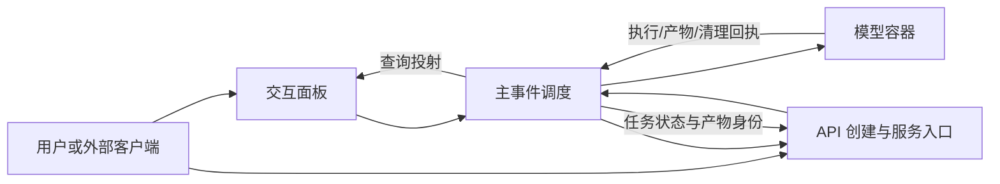
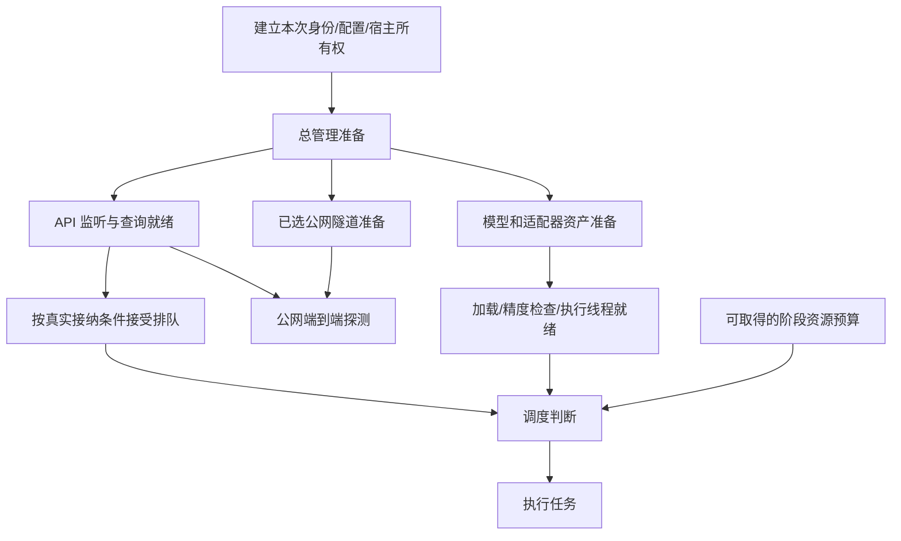
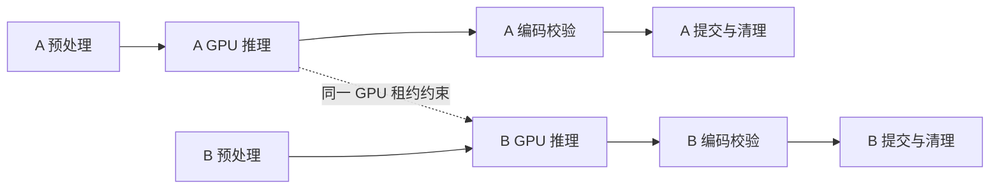

# 模块关系与真实依赖

## 责任图



图表示职责与消息方向，不是启动先后。当前 API 后台、模型容器、管理器分别为进程；隧道为管理器拥有的可选进程；控制台拥有用户操作的生命周期，但不拥有另一份生成主队列。客户端网页继续在独立仓库维护。

## 启动图



API 与模型不互相制造启动屏障。公网端到端探测同时需要当前 API 和隧道能力；模型下载完成后应检查依赖是否满足，而不是这时才创建公网。前台“API 已交付”只表示 API 及已选公网可用，不能替代模型就绪或全系统启动完成。

## 主事件有序，独立子事件并行

每个主事件的接纳、派发、终态提交、清理记录必须按自己的因果关系推进。数据库事务/锁用于状态仲裁；设计目标是不持主状态锁等待完整模型下载或推理。当前派发与取消仲裁仍在 `_control_lock` 内执行有界私有 RPC 和结果未知探测，因此不能宣称所有网络等待都已移出控制锁。不同任务可以同时被模型容器持有；单 A100 当前仅授予一个重型 GPU 执行租约。



A 编码与 B GPU、B 预处理与 A GPU可以重叠，但仍受 CPU、RAM、磁盘、设备预算约束。箭头表示真实依赖或资源互斥；不存在“每个阶段全队列做完才到下一阶段”的批次屏障。GPU 租约覆盖 CUDA 同步和 CPU 产物交接，不能因 Python 函数返回就假设异步设备工作已结束。

## 已实现的条件授权边界

当前 [condition_guard.py](../runtime/minimax_h3/condition_guard.py) 对必要条件区分 true、false、unknown、conflict；只有全部为 true 才允许对应动作。管理器在本地取消/派发仲裁和事务内记录 manager.dispatch，容器接收邀约后仍在自己的锁内复验 model.execute，阶段预算在自己的锁内授予租约；跨进程观察没有组成一个全局原子事务。

[model_container.py](../runtime/minimax_h3/model_container.py) 在 prepare、GPU、encode_validate 实际开始前再次核对当前实例/尝试、能力、前序成功、取消与预算见证。阶段工作及等待资源不占用模型控制锁；只有工作成功且完成事件持久化后，stage_completions 才为 True。该顺序保留前述跨任务独立并行，drain 只阻止容器新接纳。

未知或冲突会阻断对应动作并保留 failed / condition_gate_blocked，不把取消意图覆盖成“取消成功”。查询分别投射最近门控、任务执行回执与阶段完成证据；租约获取/释放带身份、容量版本，worker 终结事件保存最终预算快照。有界历史发生截断时仍须保持 unknown，不能由当前占用为零推出整个运行没有超卖。

范围与字段见[运行时条件门控](research/runtime-condition-gates.md)；对应 [manager 反例](../runtime/minimax_h3/test_manager_condition_gates.py)与[容器反例](../runtime/minimax_h3/test_model_condition_gates.py)验证声明的本地轨迹。[0.4.0 A100 实测](research/2026-11-15-runtime-condition-results.md)单独记录新增门控的执行、并行及释放证据；正常 GPU 路径未触发未知/冲突故障，既有实验结论不因此自动扩大。

## 控制闭环与递归组合

主事件管理器持有 durable job / attempt / command 与实例身份。模型容器持有阶段资源和 GPU 租约。进程所有者持有子进程身份与退出证明。停止、取消和最终清理分别闭环：排队取消在同一仲裁域内阻止派发；已经派发需等可安全取消边界；不确定接收先按原 ID 对账，不重复生成。

递归分解采用同一套义务：父模块为子模块确定目标和边界，分配有界预算，接收带身份的观察，合并必要结果，回收资源。组合深度、重试次数、时间/资源预算由策略限制，既不要求固定深度，也不允许无限自重启。当前代码落实若干层级，不等于支持任意递归插件。

## 四种表达的等效义务

| 原事实 | API | 面板 | 日志/知识 | 不允许的替换 |
| --- | --- | --- | --- | --- |
| 已接收，模型未就绪 | queued + waiting_for | 等待模型就绪 | 排队事件与依赖缺口 | 已生成、开始 GPU 推理 |
| 已配置 Turbo，未执行 | requested，effective=null | 请求选项/实际待确认 | 部署配置与任务观察分列 | 已实际使用 Turbo |
| 命令返回未知 | 原 command/job ID 可查询 | 待核对，不自动重发 | 原 ID 和错误原因 | 命令失败、可以重提 |
| 产物校验成功 | succeeded + artifact hash | 可预览/下载 | 媒体校验回执 | 用户已下载、质量达标 |
| 服务进程已退出 | cleanup receipt | 服务已停止 | 退出与清理证据 | 云实例已释放 |

对应判断的等效性要用反例检查：旧 ready、缺字段、部分成功、迟到消息、请求丢响应、取消与派发竞争、最终回执缺失。数学证明、有限状态枚举、CPU 测试与真实运行是不同证据层，本仓库不把其中一种冒充其余全部。

## 第一性原理的参照物

保持理想全并行物理下界作为参照。对事件 DAG 的每个节点 i、共享资源 r，输入工作量 w(i,r) 与同单位每秒容量 c(r)：

```text
节点下界       l(i) = max_r w(i,r)/c(r)
理想全并行下界 Lr  = max_r sum_i w(i,r)/c(r)
依赖关键路径下界 Lp = max_path sum_i l(i)
整体必要下界   L   = max(Lr, Lp)
```

它假定可重叠工作理想重叠，仍保留真实依赖与共享物理池；`L` 是乐观必要下界，不保证存在可实现的调度达到它。显存/内存容量限制可行性，不等于带宽。相同物理池不得复制命名来凭空增加资源。

现有 [performance_model.py](../runtime/minimax_h3/performance_model.py) 可以检查输入单位、DAG、未知值并计算已声明工作量的下界；模板没有完整模型 FLOPs 或带宽实测。跨任务的 I/O 维度当前仅检查磁盘容量，尚无带宽标定；已有 CPU、RAM、GPU 预算不因此被否定。当前**没有证明全局最优分配**。选择吞吐、单任务延迟、尾部延迟、成本等目标与阈值后，才谈该场景的优化；`T/L` 也不是设备利用率或加速倍数。

0.2.0 的[研究实验](research/2026-11-15-results.md)补充了 A100 微基准、真实阶段事件和有限调度反例：必要下界为 3 的简单模型，其最优可行值为 4；真实任务观察到跨任务 CPU/GPU 阶段重叠。独立测得磁盘/传输速率并未接入运行时带宽准入，模型全工作量和整体物理效率仍未知。完整推导见[三类参照的边界](research/physical-and-empirical-bounds.md)。
