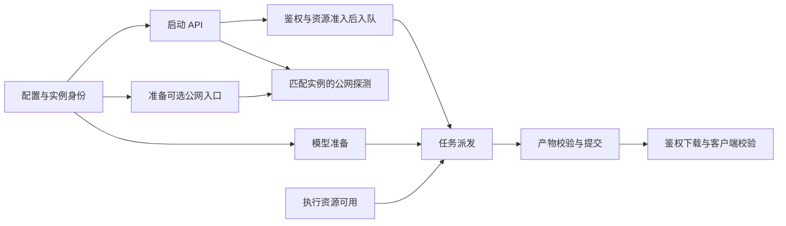

# API 创建模块

契约版本 0.1.0。机器记录：[api-factory.json](../../knowledge/modules/api-factory.json)。这里的“创建”指配置一个有身份、有权限边界、可观察和可回收的 API 服务实例，包含可选的公网入口生命周期；不表示为每个任务生成任意代码或动态安装任意插件。

当前 `server.create_app()`、启动宿主与隧道实现了 **MiniMax-H3 ref2va 的专用参考服务**。通用 API 工厂是本文要抽出的契约，尚未实现任意模型、任意路由或多租户供应系统。API 不拥有模型权重，也不复制主调度器中的主任务真相。

## 四视角 × 四类判断

| 视角 | 主观抽象的需求 | 客观具象的条件 | 主观具象的可选策略 | 客观抽象的可选验证指标 |
| --- | --- | --- | --- | --- |
| **核心** | 让外部调用者获得稳定、可审计的服务入口，并让 API 可用性与昂贵模型准备解耦。 | 当前 API 创建需要服务实例身份、公开 Bearer 密钥、私有 manager 连接和独立控制密钥；私有 RPC 监听 loopback。公开 `/v1/` 请求有鉴权，`/health/live` 仅报告 API 自身活性和身份。模型就绪不是启动 API 或准备隧道的前置条件。 | 当前选 FastAPI + 本机管理器 RPC + 可选临时 Cloudflare 隧道。可替换传输、部署器和证书入口，但须保持身份与就绪语义；接口能力由已配置且受支持的适配器生成，不接受任意插件 URL。 | 分层能力误判率；未授权请求被错误接纳率。功能隔离是必要条件，使用哪项测量是场景选择。 |
| **交互** | 调用者能先排队、持续查询、按 ID 取消，并在结果确认后拿到正确文件。 | POST 接收、主任务入队、GPU 执行、产物提交分别发生。任务与命令有身份；幂等键包含输入及加速参数指纹。最终实测出现含 job ID 的 503，后台已接纳任务，网页按原 ID 对账后取消。当前上传并发最多 3 份、总参考最多 64 MiB；这不是主队列条数上限。 | 异步 202 + 状态查询；提交未知时保留输入和身份，先对账不盲重发；已终态产物采用鉴权下载和长度/SHA 校验。可选未来事件流须保留断线恢复游标与同样终态判据。CORS 来源策略与 Bearer 鉴权分别管理。 | 未知提交后的额外执行次数；排队取消确认延迟；验证后下载完整率。不能用 HTTP 2xx 比例替代业务完成率。 |
| **递归** | 多个服务实例或子部署能在相同生命周期契约下组合，每个实例有独立所有权与清理证据。 | 当前 manager 受管启动 API、模型和可选隧道；API 与隧道有父进程观察。模型子实例可重启而服务实例身份仍需保持一致。`stop_api`/`shutdown` 会切断自身响应通道，因此要求稳定 command ID 并可从存活管理入口对账。 | 通用工厂可由父编排器持有子工厂句柄，汇总已绑定实例的观察，并按依赖清理；公私控制通道分开。一个模型服务实例失败不自动递归重建全部依赖，不无限创建临时公网地址。当前没有多实例集群工厂。 | 关闭后遗留受管端点/进程数；跨实例回执被错误接纳次数。子模块都成功不能自动推出组合成功，必须观察交接。 |
| **表达** | URL、活性、可达、准入、模型能力和任务结果各表达本来命题，外部客户端不会被一枚 success 误导。 | 隧道分配候选 URL 与注册连接分开；manager 通过匹配实例的活性探测确认公网 API。`supported`、`configured`、`ready` 分开；请求配置与实际执行配置分开。只有任务成功且产物身份/长度/哈希有效才提供视频下载。 | 用结构化状态字段和分层错误回执；OpenAPI/文档/JSON/面板保持同一映射。把 unknown、stale、明确拒绝、当前失败分开；百分比没有分母就不编造。可选聚合标签必须能展开原命题。 | 契约投射反例数；能力观察陈旧度。版本号、端口监听或 URL 字符串存在均不能代替相应能力见证。 |

## 生命周期谓词，而非一条万能状态

下列是**设计层谓词**，不是给现有响应新增字段的承诺。当前对应字段与见证见右列。

| 设计谓词 | 当前可用见证或条件 | 不能推出 |
| --- | --- | --- |
| `configured` | 启动配置与受支持选项；`/v1/capabilities` 的 configured | 模型已经下载或选项已实际应用 |
| `authenticated` | 当前请求通过公开 Bearer 检查；公私密钥边界 | 其他请求也有权限，或浏览器跨域已获允许 |
| `api_live` | `/health/live` 返回匹配服务 instance_id，API 受管进程存活 | manager 可达、模型 ready、生成成功 |
| `exposure_allocated` | 隧道状态文件有候选 URL | 公网请求已经能抵达 API |
| `public_api_reachable` | 连接注册 + 匹配实例的公网 API 探测 + 新鲜观察 | 模型 ready、队列可接纳、现有任务已完成 |
| `admission_open` | manager 队列接纳策略、上传校验及真实磁盘/并发预算通过 | 当前就能获取 GPU；主队列条数无固定上限也不是无限资源 |
| `model_ready` | 当前实例的模型加载、worker 存活与执行能力观察已确认 | 新任务接纳条件或阶段资源已满足，某个具体任务已经运行或已生成文件 |
| `artifact_committed` | 主任务 succeeded，产物校验并提交；下载再次核对归属/长度/SHA | 客户端已下载、用户满意、释放后还能下载临时文件 |
| `cleanup_confirmed` | 所有者退出观察 + 最终清理回执；平台 VM 释放另有观察 | 只看到 API 断线就说明模型、隧道和 VM 全部退出 |

图没有“模型下载完成 → 才开始公网准备”的边。公网探测需要 API 和传输入口，但不需要模型；生成派发需要模型与资源，而不是“收到 URL”。程序运行中的 readiness 可撤销，历史完成事实不能被当作永远成立的前置条件。

## 可选指标的测量契约

以下是待场景选择的指标定义，不表示全部已有自动采集。采用后应冻结样本窗口、对照条件、阈值与失败/未知的记法。

| 指标 ID 后缀 | 定义与单位 | 作用域、未知与阈值 |
| --- | --- | --- |
| `core.capability-misclassification` | API 层能力判定与同身份、同时效独立见证相矛盾次数 / 可判定能力观察数，无量纲。 | 分 api_live/public_api_reachable/model_ready/admission 等命题报告。没有独立见证或分母为 0 时未知；正确性验收要求已知反例为 0，不要求未知被当成成功。 |
| `core.unauthorized-admission` | 无效/缺失公开凭据仍到达受保护副作用处理器的请求数 / 注入的无效受保护请求数，无量纲。 | `/v1/` 路由与方法矩阵，排除明确公开的活性接口和预检请求。采样无效则未知；采用为验收时为 0。该指标不证明完整安全性。 |
| `interaction.extra-executions` | 每个语义幂等请求实际执行次数超过允许次数的正差求和，次。 | 断连、超时、含 job ID 的 503、恢复和重复提交故障注入窗口，按持久记录和 attempt 对账。没有执行审计时未知；采用为正确性验收时为 0。 |
| `interaction.queue-cancel-latency` | 取消命令被管理器接收至任务 cancelled 且 cleanup_complete 的单调时间差，毫秒，报告样本数和分位数。 | 排队取消与执行中安全边界取消分别统计；后者不能套排队阈值。缺少任一见证或时间不可比时未知；阈值按队列后端与控制周期选择。 |
| `interaction.verified-download-rate` | 长度、SHA 与完整解码均通过的下载数 / 已请求且已有已提交产物的下载数，无量纲。 | 固定网络条件与测试窗口，另报中断/失败/未知数量；没有尝试时未知。最小闭环每个被接受为成功的下载都必须通过，跨场景服务目标另行选择。 |
| `recursion.residual-endpoints` | 关闭期限后本实例所有权树中仍存活的 API/隧道进程及仍可到达的受管端点数量，个，按类型分别报告。 | 只计已登记的本实例资源，记录探测范围；不可观察项为未知。声明清理完成时受管残留必须为 0；云平台 VM 释放还需平台见证。 |
| `recursion.cross-instance-acceptance` | 接纳了不匹配 expected_instance_id 或当前任务/模型子实例的回执次数，次。 | 模型重启、API 重启、迟到回执和多实例注入窗口。身份缺失无法核验时未知；采用为验收时为 0。 |
| `expression.contract-counterexamples` | 同一输入类经文档/API JSON/客户端投射后违反指定命题映射的不同反例数，个。 | 固定契约版本、抽象输入划分及场景；未检查的类记 unknown，不能把零已发现反例当作全称证明。已覆盖类验收目标为 0。 |
| `expression.capability-age` | 使用能力观察的时刻减去该观察产生的时刻，秒，并报告来源和时钟误差。 | 以实例和能力类型分组；时间不可比或无观察时未知。超过所选新鲜度门限后撤销当前可用推断，不抹去历史成功。 |

## 当前实现、替换边界与证据

- [server.py](../../runtime/minimax_h3/server.py)负责公开 HTTP、鉴权、上传暂存、参数校验、任务/事件查询和下载；[global_manager.py](../../runtime/minimax_h3/global_manager.py)持有队列、命令、控制与跨进程协调；[tunnel.py](../../runtime/minimax_h3/tunnel.py)只准备并报告传输入口。API 工厂替换不能偷偷把这三种状态归属合成一份本地缓存。
- [startup.py](../../runtime/minimax_h3/startup.py)持有启动宿主；[process_owner.py](../../runtime/minimax_h3/process_owner.py)提供进程身份和退出观察；[generation_options.py](../../runtime/minimax_h3/generation_options.py)提供当前 BF16 能力与参数规则。当前 `create_app()` 已可注入 controller 供测试，但这不等于模型协议已通用化。
- [服务测试](../../runtime/minimax_h3/test_server.py)、[跨域测试](../../runtime/minimax_h3/test_server_cors.py)、[实例归属测试](../../runtime/minimax_h3/test_server_manager_identity.py)、[主调度测试](../../runtime/minimax_h3/test_global_manager.py)覆盖相应局部反例。结构和 CPU 测试不能替代公网/GPU验收。
- [2026-11-15 验收记录](../../evidence/acceptance-2026-11-15.json)包括 API 先行上线、两项模型下载期排队、指定取消、真实生成、下载与服务/VM 分别释放；保留一次早期依赖失败和后续短暂 503，不把恢复后的成功追溯成全程无错。

未来可选路线包括 API schema 由模型能力适配器生成、持久化公网地址、事件订阅、多实例部署、租户和配额隔离。每条路线都需要新的客观条件与验收，当前没有任意插件执行、任意模型兼容、生产多租户隔离或数学最优吞吐量的保证。

## 0.2.0 研究观测与指标对应

[0.2.0 研究](../research/2026-11-15-results.md)的[客户端记录](../../evidence/research-2026-11-15/client-receipt.json)保留公网可用、模型未 ready 的提交前观察、三项排队接纳、两项成功成片验收和一项取消。[轨迹分析](../../evidence/research-2026-11-15/analysis.json)确认该轮取消目标没有派发记录，并分别核对任务、进程和平台释放证据。

这些事实不自动满足九项候选指标的严格定义。两个最终下载均通过验证，但公开记录未包含全部下载尝试、重试和中断分母，因此 `interaction.verified-download-rate` 暂为 unknown。取消端到端流程已观察，不代表已经测得管理器接收至清理完成的精确单调时延。未注入的无效鉴权、丢响应、跨实例故障不记零；全受管端点关闭探测、跨表达输入分类和能力使用时刻也缺少完整样本。0.2.0 的九项指标各自保留 unknown 原因，正常路径通过与尚未测量可以同时成立。

## 0.4.0 历史条件与 0.5.0 当前投射

外部调用者需要可审计入口、持续查询和正确结果的需求不变。0.4.0 已新增带实例、任务、尝试及决策身份的条件回执；[实测报告](../research/2026-11-15-runtime-condition-results.md)与[公共查询见证](../../evidence/runtime-conditions-2026-11-15/api-query-observation.json)确认运行中可通过单任务接口取得派发条件回执。这份见证不表示每个阶段的实时回执都已在同一路由提供。

| 已更新的客观条件 | 现有策略的覆盖与缺口 | 应同步的验证范围 |
| --- | --- | --- |
| `public_condition_fields` 已投射 `condition_gate`、`execution_condition_gates`、`stage_completions`、`cancellation_requested`。必要条件保留 true/false/unknown/conflict；必要条件字段缺失或非全真却声称允许时降为 `allowed=null`。 | 单任务路由采用固定字段与上下文白名单，过滤任意参数和路径；这项收窄只描述该路由，不意味着 `/v1/system` 全量诊断也使用同一白名单。条件回执是历史决定，不是客户端可以持有并再次执行的授权票据。 | [公共投射反例测试](../../runtime/minimax_h3/test_server_condition_projection.py)覆盖所声明的本地字段行为；仍需将文档、单任务接口、系统诊断及客户端的同身份输入分类一一对齐。 |
| 模型容器的活动 `attempts` 已包含阶段条件与完成见证。 | 当前 `_public_job` 按 manager/job/attempt/model 身份和观察年龄投射运行中阶段回执，拒绝旧实例、旧尝试、缺时间及晚于快照的决定。`execution_observation.status` 区分 current/historical/stale/unknown/identity_mismatch；current 只限定快照，内部回执仍是历史决定。终态证据先落主账本再 ack，重启后仍可查询。 | [实时投射测试](../../runtime/minimax_h3/test_live_condition_projection.py)覆盖准备、GPU 等待、编码、迟到、缺失、取消、ack 和恢复；有限 CPU 反例不扩展历史 GPU 验收范围。 |
| 实际执行允许与实际完成已有不同见证，取消意图也不会覆盖已报告的条件失败。 | `waiting_for` 当前区分 current_observation、condition_verification、model_identity、model_ready、model_capacity 等等待。`condition_summary` 的当前观察与 `last_decision` 分离，不把旧拒绝继续当作当前原因；取消意图由持久主任务状态保留，不被滞后的模型标志撤销。 | 继续区分条件缺失/冲突、允许但未开始、开始但未完成、失败同时存在取消意图；未检查范围保留 unknown。 |

新增 `GET /v1/audit/budget` 使用同一 Bearer 鉴权，要求 `model_instance_id`、`budget_instance_id`，接受非负 `after_sequence`、可选固定 `through_sequence` 与 1–256 的 `limit`。返回固定范围的事件、连续序号、首尾哈希、`page_complete` 和 `more`；调用方沿 `next_sequence` 分页并保留同一 cutoff。管理器在 RPC 前后复验模型归属，RPC 不持主状态锁；身份变化返回 409、游标错误 422、审计不可确认 503。固定白名单不提供路径、密钥或任意 grant 上下文；页内连续性和摘要必须核对。[真实持久页的 HTTP 边界测试](../../runtime/minimax_h3/test_budget_audit_projection.py)覆盖该链路，完整跨页覆盖仍由分析器核验。

上述当前修复与历史证据分别记录。完整跨表达指标仍不能从有限反例推出；0.2.0 和 0.4.0 的 GPU 窗口不被新源码覆盖，也不自动成为 UI、故障注入或全部下载请求分母。
