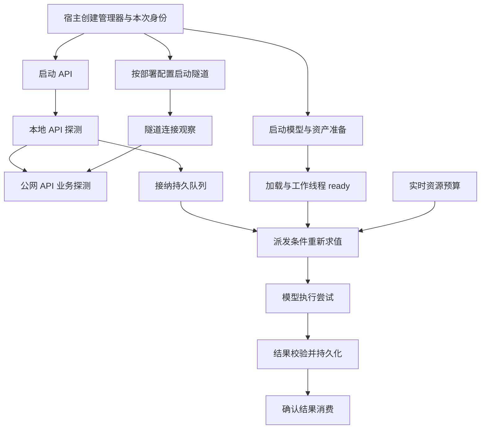

# 主事件调度模块

契约设计版本 `0.1.0`。当前实现状态：**MiniMax-H3 专用参考实现**。总管理拥有主事件账本、跨模块命令和进程所有权；模块内部的 CPU/GPU 阶段由模型容器执行。通用化目标是复用这一责任边界，不是把全部模块塞进一个全局线程。

## 四个视角与四类判断

| 视角 | 主观抽象的需求 | 客观具象的条件 | 主观具象的可选策略 | 客观抽象的可选验证指标 |
| --- | --- | --- | --- | --- |
| 核心 | 使用者希望主任务只有一个可追溯的事实来源，从接收、等待、执行到产物提交和回收能闭合。 | SQLite 保存任务、命令和事件；任务、尝试、模型实例与管理器实例分别有身份。API/模型/隧道活性、就绪性和退出情况来自独立探测及所有者观察，缺失观察不能当作成功。 | 选择 durable FIFO、超时预算、排空规则、故障隔离及恢复策略；当前不自动重放结果未知的生成，控制重试使用稳定命令 ID。 | 主事件完整率、重复执行数、未知状态收敛时间；不能把 HTTP 成功比例当作任务成功比例。 |
| 交互 | API、面板与模型应通过明确命令和回执协作，慢模型不能阻塞查询，也不能把不同实例的结果混在一起。 | 公共任务回执归属管理器实例，可替换模型另有子实例 ID；结果必须匹配 job/attempt/model。公共 API 已可用时可接收队列，派发还需当前模型 ready、accepting 和资源准入。 | 选择 API、模型、隧道独立启动与并行探测；可先交付 API 后等待模型，不把权重下载完成设为公网启动门槛。控制渠道与生成渠道分开受管。 | API 可达时延、模型等待期查询可用率、命令对账成功率；探测范围须明确本地、公共入口或业务能力。 |
| 递归 | 复合事件可按真实依赖展开，独立子事件并行；所有子事件的资源、失败与取消仍归属于父事件。 | 当前主任务状态转移和取消/派发仲裁有序，三个准备分支可并行；每个任务的 prepare→GPU→encode 具有因果依赖。共享 CPU/GPU/RAM/磁盘容量是全局约束。 | 选择拓扑就绪队列、预算内流水、失败传播或补偿；可依据已标定带宽与工作量优化策略。未有测量时保留 unknown，不用固定串行链替代依赖分析。 | 关键路径下界差距、无必要等待时间、阶段重叠比例、资源超借数；局部最优或启发式不能宣称全局物理最优。 |
| 表达 | 状态、日志、图和自然语言应表达相同事实，并保留“未发生”“不允许”“未知”“已完成”的区别。 | `waiting_for` 表示当前阻塞条件，`dispatch_reason` 是上次拒绝原因；`active_phase` 属于当前尝试。API readiness、任务终态、产物合格、服务清理和平台释放为独立命题。 | 选择字段投射、事件汇总、失败分类和审计保留；可用 DAG、状态表、布尔前提或文字表达同一合约，并以反例检验投射。 | 表达等效反例数、事件身份覆盖率、终态证据完整率；更多日志不自动降低认知负荷。 |

## 调度判断的统一语义

对事件 `e`，可以用下式审查一个候选调度器：

```text
can_start(e,t) = 本事件的当前尝试尚未开始
                 ∧ 真实依赖在 t 时满足
                 ∧ 本次资源可准入
                 ∧ 所有者/实例身份有效
                 ∧ 当前策略允许
```

这是设计层的判据，不是声称源码已直接实现这个函数。再次尝试必须有明确的新尝试身份和重试策略，不能通过清空“已启动”状态偷偷重复执行。

- `completed(e)` 是一次事件的已记录历史结果；它不单独决定下一个模块能否开始。
- `ready(m,t)` 是模块此刻能够提供某项能力的观察，可能被故障或停止撤销；进程存活不能推出 ready。
- `admitted(job)` 是接纳了请求或拥有执行尝试；不推出已经取得 GPU，也不推出最终成功。
- `artifact_verified(job)`、`cleanup_complete(owner)`、`platform_released(instance)` 由不同观察者负责，不合并为一个万能 success。

例如，权重下载完成后应重新检查模型加载的真实前置条件；公网隧道本来就是独立准备分支。可以在同一个决策周期检查它是否已经 ready，但不能因此强迫它等下载后才启动。



图中 `P → Q` 表达 API 接纳能力的依赖，不表示每个任务提交前另跑一个完整探测流程。公网 API 的交付依赖 API 可达与隧道可达；模型推理不依赖公网交付。选择只在本地使用时，公网分支不属于该实例所需能力。

## 主事件有序与子事件并行

主事件的“串行”应限定为冲突状态转换的有序仲裁：同一任务的派发与取消不能各自赢一次；提交主账本必须早于模型丢弃结果。它不要求独立模块安装、模型加载、网络探测、CPU 预处理和编码全部串行。

当前 `GlobalManager` 维护唯一主队列，模型容器维护被接纳尝试和阶段资源。多个任务处于 running 表示模型容器拥有多个尝试，不等于多个任务同时占有 GPU。FIFO 派发也不保证 GPU 开始顺序或完成顺序相同，因为前处理成本不同。

递归组合需要父节点分发子预算、记录子身份，并在结束时核对所有自有子生命周期；子节点仍可用相同合约再组合有限子节点。总管理只保存必要的子状态投射，不复制一份竞争的子资源账本。当前实现是固定服务树和固定执行阶段，未实现可由用户任意提交的 DAG 或跨机器一致性协议。

负反馈闭环是“观察事实 → 解释当前差距 → 选择控制 → 执行动作 → 重新观察”，不是反复重试直到出现成功字样。观察失效或结果未知时，应保持原身份并核对；确认资源压力或执行故障后可降低接纳、撤销能力或停止受管容器。现有超时和故障处理实现了部分闭环，尚未给出所有工作负载下的控制稳定性证明。

## 物理下界作为参照

对明确工作量和资源池的 DAG，设节点 `i` 在资源 `r` 上的工作量为 `w(i,r)`，资源容量为 `p(r)`：

```text
资源下界 = max_r [ Σ_i w(i,r) / p(r) ]
节点乐观耗时 l(i) = max_r [ w(i,r) / p(r) ]
依赖下界 = max_path [ Σ_i∈path l(i) ]
总下界 T_lb = max(资源下界, 依赖下界)
```

这是允许理想重叠的乐观下界；真实依赖仍保留。只在工作量、单位、拓扑、共享资源、覆盖范围和测量边界一致时比较 `T_actual / T_lb`。它不能证明可达到，也不能保证某启发式最优。内存容量是可行性约束，不能拿 GB 直接当 GB/s；主机传输、GPU HBM、存储和网络不能混用一个“带宽”。

仓库 [performance_model.py](../../runtime/minimax_h3/performance_model.py)提供缺失量显式保留的下界计算器；当前跨任务阶段调度仍主要依据 CPU/RAM/磁盘容量和单 GPU 租约，尚未把完整 H3 工作量和实测传输带宽接入全局最优化。参考媒体内部的小规模分配模型也不能代替整个服务的最优证明。

## 不可省略的约束

- 任务、命令、尝试与实例身份不可互换；旧探测或旧结果不能推进新实例状态。
- 幂等命令同身份同参数只产生一次效果；同身份不同参数拒绝。请求超时不是拒绝证明，结果未知不自动重新生成。
- 取消与派发在同一仲裁边界决定；已运行取消需等安全边界，确认停进程前不归还不确定资源。
- 成功必须有对应产物证据；先持久化主结果，再确认模型消费。失败、取消和清理未确认分别可查询。
- 正常关闭先封住新命令接纳、收敛已接收操作与子进程、持久化最终回执，再确认退出；云平台释放另行观察。

## 可选指标的测量合同

| 指标 ID | 定义、单位与分母 | 测量窗与适用范围 | 未知规则 | 阈值策略 |
| --- | --- | --- | --- | --- |
| `EO-CORE-CLOSURE` | 主事件完整率 = 同时具备接纳、因果状态转换、终态结果及清理证据的终态任务数 / 应结束的已接纳任务数；单位比例，仍运行任务另列。 | 一个封闭验收批次，从接纳开始至统一截止点，记录成功/失败/取消各类，不删掉失败样本。 | 接纳账本缺失、截止点未定或资源观察缺失则 unknown。 | 完成该批次验收要求每个任务可对账；超时与未确认项单列，不用高平均率掩盖。 |
| `EO-INT-API-DELIVERY` | API 交付时延 = 启动请求接收至当前实例所选入口首次业务探测成功；单位 s，分母为明确入口策略的一次启动或同条件启动样本。 | 区分本地/公网、冷/热启动；同一可信时钟，记录模型当时是否 ready。 | 入口身份不匹配、时钟边界不明或探测未完成则 unknown/右删失，不填为 0。 | 上限由交互场景预先设定；前台 180 秒观察窗只是宿主策略，不是已证明的服务 SLO。 |
| `EO-REC-BOUND-GAP` | 下界差距比 = 同一完整工作负载实测 makespan / T_lb；单位 ratio；分母为正且覆盖声明明确的物理下界。 | 固定 DAG、硬件拓扑、精度与起止边界；完整覆盖与部分覆盖分开，不混合启动下载和纯推理。 | 任一必需工作量、共享池容量或时钟未知时不给完整比值；部分覆盖只能标为部分下界。 | 不设虚构“最优”阈值；在相同边界下比较策略并附质量/资源约束，比值小不单独证明正确性。 |
| `EO-REC-OVERCOMMIT` | 资源超借数 = 时点/区间内实际发放的互斥租约或确认预算超出共享池的违规次数；单位 count，另报涉及资源与持续时间。 | 一个受管实例的完整资源事件序列；容量与预算调整需带版本。 | 租约端点或容量版本缺失时 unknown；RAM 估算误差另报，不能伪称 OS 强隔离。 | 当前独占 GPU 与 CPU 通道合同要求 0；RAM/磁盘估算阈值按部署余量策略选择。 |
| `EO-EXP-PROJECTION` | 表达等效反例数 = 同一带身份事件轨迹在图、布尔前提、状态表、API/面板投射中产生矛盾判断的样例数；单位 count，分母为声明的轨迹集合。 | 每次合约或投射变更的有限回归集，至少含下载完成但未加载、旧实例迟到、取消竞争与清理缺回执。 | 轨迹覆盖未声明或投射规则缺失时 unknown；零反例不声称全称等价。 | 对已声明轨迹要求 0；新增轨迹扩大覆盖而非自动完成形式证明。 |

## 实现、证据与缺口

- [global_manager.py](../../runtime/minimax_h3/global_manager.py) 与 [test_global_manager.py](../../runtime/minimax_h3/test_global_manager.py)：持久队列、派发/取消仲裁、独立准备、结果确认、实例隔离和最终回执。
- [process_owner.py](../../runtime/minimax_h3/process_owner.py) 与 [test_process_owner.py](../../runtime/minimax_h3/test_process_owner.py)：进程所有权、PID 世代和退出观察。
- [startup.py](../../runtime/minimax_h3/startup.py) 与 [test_startup_delivery.py](../../runtime/minimax_h3/test_startup_delivery.py)：受管启动、交付与清理闭环。
- [pipeline_scheduler.py](../../runtime/minimax_h3/pipeline_scheduler.py)、[resource_scheduler.py](../../runtime/minimax_h3/resource_scheduler.py)、[performance_model.py](../../runtime/minimax_h3/performance_model.py)：实际阶段预算、参考媒体分配与物理下界的不同范围。
- [2026-11-15 验收摘要](../../evidence/acceptance-2026-11-15.json)：API 先于模型 ready 交付、下载期两个任务排队、指定取消后剩余任务自动生成，随后服务清理与平台无会话。早期依赖失败和短暂 503 保留在验收范围中。

目前未证明任意 DAG 可调度性、控制稳定性、跨机一致性、全局带宽最优或通用多模型公平性。队列不设固定任务数上限仍受磁盘和资源准入约束；无界队列长度不等于无界资源。机器可读副本见 [模块合同](../../knowledge/modules/event-orchestrator.json)。
