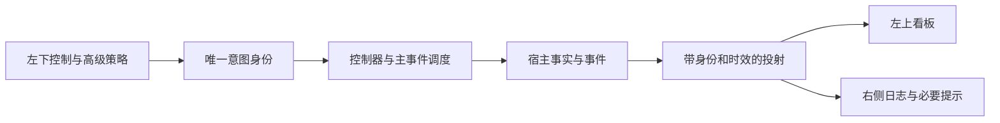

# 交互面板模块

契约版本 0.1.0。机器记录：[interaction-panel.json](../../knowledge/modules/interaction-panel.json)。当前参考实现是 Colab 控制台；独立网页客户端保留在 [simple-llm-api-web v0.9.0](https://github.com/zjj1280637679-ship-it/simple-llm-api-web/tree/v0.9.0)，本仓库不另复制一套客户端业务状态。

本模块把服务事实呈现给人，把人的选择转换成可追踪命令。它拥有显示状态、尚未确认的交互请求、视图资源与回调；主任务真相由主事件调度模块持有。这里的“静态看板”指位置和信息职责稳定、以快照显示，不表示永不更新。

## 四视角 × 四类判断

以下是通用设计契约。表中条件落到当前实现与观察；策略列包含本项目已选择的做法及可替换方向，不能把某次选择反写成普遍物理条件。指标是可选的评价方法，不会使身份一致、命令不重复执行、密钥不泄漏等基础正确性变为可选。

| 视角 | 主观抽象的需求 | 客观具象的条件 | 主观具象的可选策略 | 客观抽象的可选验证指标 |
| --- | --- | --- | --- | --- |
| **核心** | 让人用尽可能少的理解和操作成本，判断现在发生了什么、下一步能做什么。 | `console.html` 已分出左上看板、左下常用控制、右侧日志。API URL、凭据可用性、模型和 LoRA 下载状态分别有字段；快照带观察时间。当前事实源是 `ConsoleController.snapshot()` 与所绑定宿主，不是 DOM 中旧文字。 | 当前采用固定三块、常用操作直接可见、高级控制折叠；指标密度可随屏幕与任务调整，但不拆散“控制整卡一起滚动”的约定。正常启动用一个入口；异常时才展开诊断。 | 正常路径的人工启动操作数；有证据可核对的状态命题错误率。不能用点击更少替代状态正确。 |
| **交互** | 命令能被查询、取消或对账；长工作不让人重复点击，也不把请求收到了说成执行完成了。 | 控制器分 setup、generate、control 执行通道；操作有 `request_id`、指纹及 accepted/started/finished 事件。当前 Colab 前台交付观察默认最多 180 秒，在此期间暂停 RPC 按钮，由宿主推送快照，可用单元停止按钮取消。交还控制后才恢复面板查询与控制。 | 普通已授权操作直接执行；释放实例和强停模型在日志区确认。RPC 超时保留同一请求身份，先查询，人工重试相同操作时复用请求 ID，不自动重发业务命令。必要时可换为订阅传输，但须保留这些语义。 | 同一意图的额外副作用次数；可用交互窗口内的查询反馈延迟分位数。前台不可用窗口单独报告，不能从延迟样本中悄悄删除。 |
| **递归** | 总面板与子面板采用相同的观察、命令、取消、清理规则，增加模块时不增加失控的后台活动。 | 当前控制器复用已有挂载，旧面板回调会失效；单面板只允许一个状态读取在途，隐藏或暂停时停止定时轮询。启动请求绑定具体宿主与实例，旧宿主的停止回执不能结束新启动。监测子进程也登记到所有者。 | 通用组合可将每个子模块投射为同一面板契约，由父面板汇总有边界的快照；父级关闭先取消并等待受管子工作，再回收父资源。仅按资源预算展开子视图，不递归创建无界轮询、弹窗或重试。 | 关闭后的受管视图/监测资源残留数；旧实例或旧挂载结果错误写回次数。当前实现不是任意深度的通用面板树。 |
| **表达** | 看板、控制回执和日志对同一事实说同一件事，并把未知留作未知。 | 看板与日志分别读取快照/事件；URL 已分配和已验证可达分开，下载完成和模型就绪分开。只有完整分母可知时显示下载百分比。普通快照和日志脱敏，密钥只经专用回调显露，并在隐藏、断连或凭据变化时清空前端明文。 | 看板保留简短状态，详细原因、确认和下载入口放右侧日志；使用时间和实例身份限定观察，过期时撤销“当前可用”表达。既有事实可保留为“上次已加载”，不能延续为当前 ready。 | 跨表达投射不一致率；当前状态观察年龄。像素整齐或文字一致不能单独证明语义一致。 |

## 可选指标的测量契约

这些指标目前是设计定义，未宣称本项目已有完整自动埋点或用户认知实验。采用哪项、采样窗口和阈值由具体场景策略明确绑定；未测量写 `unknown`，不用零代替。

| 指标 ID 后缀 | 定义与单位 | 作用域、未知与阈值 |
| --- | --- | --- |
| `core.start-actions` | 从已分配且通过资源条件的运行时开始，到 API 交付前必须由用户完成的启动操作数，次/轮；统计点击或等价键盘操作，不计无关浏览。 | 仅无异常正常路径。本实例设计目标是运行唯一启动单元 1 次；条件不满足、断连和确认另列。没有完整操作记录时未知。 |
| `core.claim-error-rate` | 被证据反驳的状态命题数 / 同一测试窗口内可核对的状态命题总数，无量纲。 | 覆盖可达、就绪、排队、终态、清理，按实例及观察时刻对齐。分母为 0 或观察缺失时未知；采用为正确性验收时反例必须为 0，有限样本不是全称证明。 |
| `interaction.extra-effects` | 同一 `(request_id, fingerprint)` 的实际副作用数超过契约允许次数的正差之和，次。 | 一次重复点击、超时、迟到响应故障注入窗口。没有副作用审计时未知；采用为正确性验收时为 0。幂等查询次数不算副作用。 |
| `interaction.query-p95` | 从查询发起到匹配请求和实例的可用快照呈现的单调时钟间隔，按固定方法取 p95，毫秒。 | 仅已交还面板控制且可发起查询的窗口，同时另报不可用窗口时长及样本数。无匹配回执、采样过少或时钟不可比时未知；阈值按宿主和网络目标设定，不预置通用最优值。 |
| `recursion.residual-resources` | 关闭流程达到约定观察期限后，仍登记为活跃的面板计时器、回调、监测子进程数量，个。 | 仅当前面板所有权子树，不把别人的进程算入。不可观察的资源列为未知；已声明清理完成时必须为 0，否则继续报告未确认。 |
| `recursion.stale-commits` | 不匹配当前挂载/请求/实例的迟到结果，被写成当前状态的次数，次。 | 重挂载、重启与取消竞争测试。缺少身份链时未知而非通过；采用为验收时为 0。 |
| `expression.projection-mismatch` | 同一实例、同一事实版本上，UI/JSON/日志对指定命题的非等价表达对数 / 可比较表达对总数，无量纲。 | 时间不同的快照不能直接判矛盾。无共同身份或可比较命题时未知；正确性验收目标为 0，须列出抽象映射与反例。 |
| `expression.observation-age` | 呈现时刻减去事实观察时刻，秒；报告分布及最大值。 | 使用同一时间基准或已知时钟误差；跨宿主时钟不可比时未知。超出场景新鲜度门限就降为过期观察，门限依据宿主探测周期而定，不改写历史事实。 |

## 交互契约与等效性边界

通用设计可将输入拆成 `Observation`、`Intent`、`Receipt`、`Notice`，但当前代码没有声称实现这四个通用接口类。当前对应物是 `snapshot()` 返回值、`dispatch(action, payload)`、操作/命令记录，以及日志区 notice。组合时至少保留 `request_id`、服务 `instance_id`、可比较的观察时间、事实来源、请求结果未知标记；重新装载的模型子实例也不能混为服务实例。

这条反馈链并不要求看板读取、日志读取和所有后台任务串行。对同一命令的接收、执行、完成有因果顺序；独立子事件由其所有者按预算并行。启动观察到期只表示交还界面，不表示启动失败；命令 accepted 也不表示 ready。释放服务进程与释放 Colab VM 是两个独立事实。

最小反例集：旧宿主已停止但新宿主还未绑定；模型下载 100% 但加载失败；URL 已分配但探测失败；命令提交超时但已在后台接收；父面板消失但监测子进程仍活着；旧密钥回调晚到且当前凭据已变；同一状态被日志和看板分别解释成“完成”和“可开始”。这些反例对应的基础不变量必须保留，不能为降低弹窗数而删除。

## 当前落地与验证范围

- [控制器](../../runtime/minimax_h3/notebook_console.py)、[三块视图](../../runtime/minimax_h3/console.html)、[状态表达](../../runtime/minimax_h3/notebook_ui.py)是已落地的 Colab 参考实现。
- [控制台测试](../../runtime/minimax_h3/test_notebook_console.py)、[连接与凭据测试](../../runtime/minimax_h3/test_console_connection.py)、[启动交付测试](../../runtime/minimax_h3/test_startup_delivery.py)、[子进程生命周期测试](../../runtime/minimax_h3/test_console_process_lifecycle.py)覆盖各自命名的反例。测试存在不等于所有通用宿主都满足契约。
- [2026-11-15 验收记录](../../evidence/acceptance-2026-11-15.json)记录当前实例一键启动、下载期排队、指定取消、真实生成、下载及释放；没有认知负荷量表、用户完成时间对照或可访问性全覆盖测量。

尚待验证的通用化包括：多种模型能力的动态表单映射、非 Colab 宿主 transport、任意嵌套面板的预算与销毁、键盘/读屏完整操作、不同屏幕上的认知成本比较。每个扩展都需要自己的条件、策略选择、指标和证据，不能仅因复用同样布局就判为等效。

## 本轮研究的面板证据边界

[2026-11-15 新研究](../research/2026-11-15-results.md)使用受管 API 客户端完成生成与下载，见[客户端记录](../../evidence/research-2026-11-15/client-receipt.json)和[源码身份范围](../../evidence/research-2026-11-15/provenance.json)。本轮没有重新测量网页 UI 或控制台交互；后台轨迹及服务清理不能替代面板操作、呈现时间、回调清理或同源投射样本。

因此本轮八项面板指标全部保留 `unknown`，并逐项记录缺少的证据。既有布局及历史功能验收仍作为历史来源，不将“没有修改布局”解释成新的 UI 实测或认知负荷改善证据。
