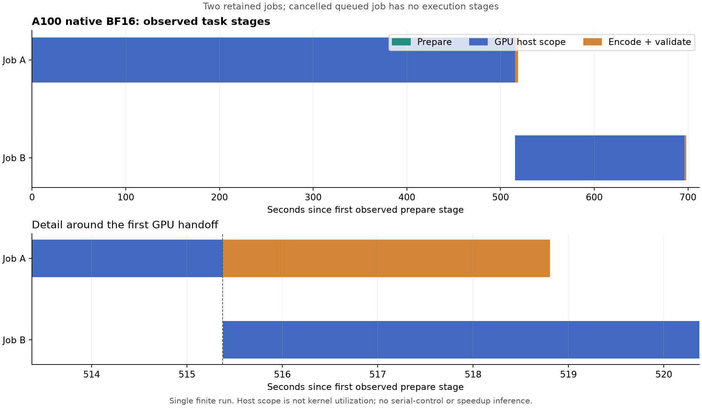

# A100 BF16：第一轮架构实证

2026-11-15（北京时间），在一个 Colab **NVIDIA A100-SXM4-80GB** 实例上完成有界实验：启动前设备微基准 → 一键启动 → 公网 API 接纳 → 模型未就绪时提交三个全新单图任务 → 取消其中一个 → 其余两个生成、外部下载及完整解码 → 服务清理 → 平台会话释放。原单按钮笔记本已恢复，布局未改。

本轮形成可复核的单实例基线，支持若干架构能力；**没有证明全模型达到硬件极限、调度全局最优、长期稳定或任意云平台适用**。源码版本为仓库 0.2.0 的研究增量，基线为 `db7d10051f7259ad8ce1e8bf0d155a33fa329ff5`。运行时代码只给模型与管理器事件增加单调时钟，没有改变调度、精度或面板。导出时的 30 个运行时文件均与本仓库对应字节一致；这不等于对已加载进程内存作密码学证明。

## 可复核材料

- [完整公开证据目录](../../evidence/research-2026-11-15/)：字段白名单投射后的事件、预算快照、终态、客户端回执、校准样本、时间图、输入与两个视频。
- [运行身份与源码](../../evidence/research-2026-11-15/provenance.json)、[分析结果](../../evidence/research-2026-11-15/analysis.json)、[客户端回执](../../evidence/research-2026-11-15/client-receipt.json)。公开投射与私有完整轨迹的 13 项分析结果逐项相同。
- [实验前协议](../../research/protocol.json)、[测量审稿](measurement-review.md)、[轨迹审稿](trace-review.md)。协议是事前本地工作记录，没有独立时间戳或外部预注册。

原始数据库、连接密钥、公网地址、完整日志、本机路径和平台截图没有上传。原始证据包及平台截图的 SHA 留在公开回执，原文件保存在本地。SHA 能核对字节，不能认证观察者或证明事实独立可信。

## 实验条件和偏离

设备为 108 SM、PyTorch/CUDA 报告显存 85,094,825,984 字节（81,152.75 MiB），12 个逻辑 CPU、高系统内存；nvidia-smi 的总显存字段另报告 81,920 MiB，两个来源的口径不混写。Python 3.13.16、PyTorch 2.14.1+cu130、CUDA 13.0。BF16 主干保持原生；官方 FP32 例外保持，不做量化。两个生成均请求并记录实际使用 `native` 注意力、`lightx2v-ref2va-4step`、`steps=5`，回执为 **4 次 denoiser evaluation**；部署采用 stream offload。

每个任务都是新生成的几何参考图、新提示词和新种子。固定 512×288、请求 5 秒；模型帧数对齐后实际 124 帧、24 fps、5.166667 秒，H.264 + 双声道 AAC。相同形状不代表相同工作量或相同难度。

本轮只有一个真实服务实例。采样器约 07:28 启动，晚于服务启动，因此早期过程依赖从序号 1 导出的持久事件和客户端记录，不宣称采样器覆盖了全启动阶段。浏览器定位研究单元时曾再次执行启动单元；宿主复用原实例，没有产生第二轮生成。采集器与客户端源码在执行时冻结；分析器在事后审稿中补充完整性反例，原始事件没有重写。

协议中的 cold-start 仅落实为本次新建运行时/服务启动；文件系统、宿主、网络和设备缓存未完整控制，**不认定为受控冷缓存实验**。本轮没有故障注入、运行中取消、LoRA 切换对照或网页 UI 验收，采用独立 API 实验客户端完成上传/排队/取消/查询/下载。GPU 拓扑、时钟稳定性和模型全工作量仍缺测。

## 假设判定

| 假设 | 本轮结果 | 证据及边界 |
| --- | --- | --- |
| H1 API 接纳与模型 ready 分离 | 观察范围内支持 | 三次提交前均观察到 model_ready=false，返回 202/queued；两次 GPU 阶段都在同实例 model.ready 之后 |
| H2 阶段依赖及预算所有权 | 观察范围内支持 | 两个尝试各有 prepare→gpu→encode_validate；GPU 阶段无交叠；声明 CPU 并发最高 2/12；1083 个有效预算快照未见超额。不能证明采样间物理 RAM 没有峰值 |
| H3 独立 CPU/GPU 工作可重叠 | 观察范围内支持 | B 预处理与 A GPU、A 编码与 B GPU 均有真实交集，合并计时 3.501833 秒 |
| H4 排队取消阻止派发 | 本次位置支持 | 第三个任务 cancelled，attempt_id=null，无派发和 GPU 阶段；有最终清理回执。未测取消竞争和运行中取消 |
| H5 实际精度/选项符合请求 | 本次配置支持，配置间隔离未测 | 两个成功回执均 native/BF16/Turbo/5 点 4 次评估；没有不同插件配置交替，不由此证明无跨任务状态泄漏 |
| H6 一次尝试一个结果及不确定性恢复 | 正常路径支持，故障路径未执行 | 两个接受尝试各有一个成功产物；记录 HTTP 均为 200/202，无丢响应注入或真实 503，不能继承历史故障恢复结论 |
| H7 产物完成与外部下载一致 | 两件产物支持 | 服务端与下载 SHA/字节一致，FFmpeg 完整解码及媒体结构检查通过；不是内容质量评价 |
| H8 三层资源释放各有回执 | 最终闭环支持 | 三任务 cleanup=true，服务所有者确认进程树退出，nvidia-smi 计算进程空，Colab 会话页面显示无进行中的会话 |

分析器 **13 pass / 0 fail / 0 unknown** 只指已定义的轨迹检查；不是 H1—H8 的所有子命题都已充分检验。模型流 22 条、管理器流 24 条，序号连续且有相应终结事件；完整记录仍由程序自身产生，不能排除生产者漏记物理事件。

## 实际任务与重叠

| 新内容 | 任务 | 预处理阶段 | GPU 主机阶段 | 编码校验阶段 | 外部下载 |
| --- | --- | ---: | ---: | ---: | --- |
| 峡谷珊瑚红缆车 | `63b5f94748134995b14510aa2248e3e1` | 0.024826 s | 515.339016 s | 3.430405 s | 215,537 字节，[视频](../../evidence/research-2026-11-15/assets/coral-cable-car.mp4) |
| 莲碗黄铜机械蜻蜓 | `fb99f3b62b0f432fa1a4d53127af68f4` | 0.079349 s | 180.941534 s | 1.883115 s | 291,368 字节，[视频](../../evidence/research-2026-11-15/assets/brass-dragonfly.mp4) |
| 漂浮岛琥珀灯塔 | `691ace28634f45898ee9f8af19d33b1d` | — | — | — | 排队取消，无执行尝试 |

这里使用同一模型实例事件的 `monotonic_ns`，不是 API 轮询时间或不同机器墙钟相减。GPU 主机阶段包含调用、数据移动、offload、同步等，不能当纯内核耗时。它与内部 pipeline/encode 计时的起止点不同，因此数字不同并非可以任意互换的误差。



从首个预处理开始到最后编码校验结束，阶段包围时间 **698.205961 秒**；阶段时长相加 701.698246 秒；跨任务 CPU/GPU 并集交集 **3.501833 秒**（0.074229 秒预处理重叠与 3.427603 秒编码重叠）。GPU 阶段并集 696.280550 秒。这不是一次实测串行对照，不能将时长之和当成串行运行、再计算加速倍数。

第一件与第二件耗时差异很大，同时第一件 pipeline 范围记录的进程 read_bytes 增量为 136,419,201,024 字节，第二件为 87,388,160 字节。内容、顺序、缓存、首次执行、CPU/RAM 和运行时状态同时变化；当前证据只提出“首次搬运/初始化可能占较大成本”的后续假说，不能据此归因或宣布第二种内容/策略加速。并发阶段中的进程级计数不是互不相交的逐任务计数，不能求和充当总工作量。

## 设备微基准：经验参照，不冒充物理极限

模型启动前在独立进程中运行，7 组样本；GEMM/复制/传输每组 5 次，使用完成后的 CUDA Event，主机操作用单调时钟。十进制 GB/s、TFLOP/s；完整样本和限制见 [calibration.json](../../evidence/research-2026-11-15/calibration.json)。

| 项目 | 中位数 | 本次最小—最大 | 解释 |
| --- | ---: | ---: | --- |
| 8192³ BF16 稠密 GEMM | 283.220 TFLOP/s | 261.162—283.504 | 按乘加 2 FLOP；不是混合 BF16/FP32 模型吞吐 |
| 128 MiB 设备复制，逻辑读+写 | 1682.567 GB/s | 1663.350—1693.437 | payload 中位 841.284 GB/s；没有 HBM 硬件流量计数 |
| pinned 主机→设备 | 12.302 GB/s | 12.300—12.308 | 单向、完成同步 |
| pinned 设备→主机 | 13.169 GB/s | 13.166—13.175 | 两方向分开测，不能相加冒充单向带宽 |
| 单路主机复制，逻辑读+写 | 10.416 GB/s | 10.301—10.465 | memoryview 路径，不是所有 CPU/NUMA 的总能力 |
| 32 MiB 文件写入+fsync | 0.426 GB/s | 0.379—0.434 | 应用可见文件操作 |
| 写后立即读取 | 1.585 GB/s | 1.572—1.712 | 缓存未控制，不能称物理磁盘读带宽 |

7 组是一次机器上的重复，不是 7 次独立云实例，不能给出跨环境置信区间。GPU 显式分配峰值 411,174,912 字节；结束清张量后仍记录 **8,519,680 字节 allocated**，`explicit_allocations_released=false`。保留该非零事实，不用 empty_cache 冒充进程退出。随后独立校准进程正常退出；最终服务清理后另有计算进程为空的证据。

系统/GPU 采样分别 1084/545 次，探测耗时中位 13.915/28.534 ms；系统采样最大间隔 6.787 秒。采样器不加入逐样本 CUDA 全局同步，但没有做关闭采样器的对照，因此不能声称零扰动。1083 个有效预算快照来自最终 trace 的 1085 条观察（含收尾观察），与周期采样次数不是同一分母。

## 补上的理论空白

第一，物理必要下界 **不保证可达**。对三个独立、不可抢占、持续 2 tick、各占 1 单位资源的任务，共享容量 2，资源下界为 3，路径下界为 2，所以组合下界是 3；有限穷举的最优完成时间却为 **4 tick**。125 个起点组合的结果见 [有限模型记录](../../evidence/research-2026-11-15/finite-model.json)。这些 tick 不是 GPU 秒。

这个特例还能给出连续时间证明：若总时间 T<4，则每个长为 2、位于 [0,T] 的区间都覆盖公共非空区间 (T−2,2)，三个任务必同时占资源，违反容量 2；T=4 的两批方案可行。因此该特例的最优值确为 4。证明不推广到任意 DAG 或当前推理调度。

第二，同一物理池在两模块中各取一个别名，并不产生两份容量。有限模型用同一 GPU 的两个别名能伪算出 2 tick，归并为真实池后必须 4；错误方案在真实池约束下不可行。递归预算要传递资源身份，不能只传递局部数值。

第三，独立 CPU/GPU 工作若被人为依赖串起来，会把简单模型的 2 tick 增为 4；真实运行则给出了跨任务重叠见证。**状态仲裁有序不要求全任务阶段串行**，但仅有重叠仍不等于吞吐最优。

第四，经验吞吐不是严格物理容量上界。当前仍没有全模型 FLOPs、HBM/PCIe 字节、完整依赖工作量及竞争计数，整体理论最短时间和 `T/L` 均保持 **unknown**。用本轮耗时反解工作量再代回证明自身会构成循环论证。

## 表达与测量系统也需要反例

审稿后分析器补齐了六类缺口：漏终态回执、缺 ready 前提、伪造完整标志、未绑定所有者身份、旧/停机快照误计预算、平台释放记录未绑定实例。新增反例要求缺证据输出 unknown，不能仅因“没看见错误”就输出 pass。这些是分析工具的事后改进，不改写为协议预先具备的检查。

任务回执还有可改进的表达：部署 `runtime_options.attention_backend=auto` 与该任务 `generation_options.effective.attention_backend=native` 同时存在；静态适配器目录中的 `validation=not GPU-tested` 不能覆盖本次执行回执，也不能凭一次执行改写为所有环境已验证。报告使用逐任务 effective，并把这些标注作用域区别列出，未在运行途中修改业务代码。

## 下一轮的判别实验

1. 保持每次新内容，以同形状输入随机分配策略并重复，拆开首次执行与后续执行；当前两个样本不能估稳定尾延迟或收益。
2. 在独立受控实例做真实丢响应、取消竞争、进程退出及恢复实验，预设有限故障次数和停止条件；补 H6 与运行中取消。
3. 用低扰动 profiler 统计实际模型分阶段 FLOPs、HBM/主机搬运量、kernel 与 transfer 时间，核对共享带宽竞争后再更新经验调度策略。
4. 明确质量约束、到达率、吞吐/尾延迟/成本目标，再做负载稳定性与跨平台复现。没有目标和完整工作量时，不优化一个无定义的“全局最优”。

## 本地复核

无需申请 GPU 即可重放已公开的证据分析；安装仓库 CPU 测试依赖后执行：

```bash
python research/analyze_trace.py evidence/research-2026-11-15/trace.json
python research/check_bound_cases.py --output finite-model-new.json
python -m pytest
python tools/check_knowledge.py
python tools/check_publication.py
```

时间图额外需要 matplotlib（本次 3.11.2），生成命令为 `python research/plot_trace.py evidence/research-2026-11-15/trace.json --output timeline`。图重新生成可能因字体或渲染依赖有字节差异，以事件、区间及数值为复核对象。真实重跑必须新建内容清单，不直接复用本轮输入生成。
