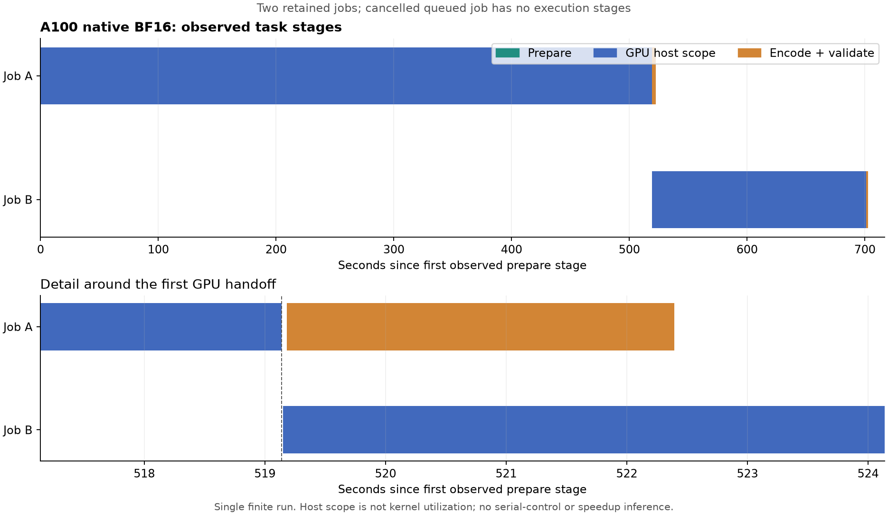

# A100 原生 BF16：运行时条件门控实测

2026-11-15（北京时间），本轮在 Colab NVIDIA A100-SXM4-80GB 上完成一键启动、公网 API、全新单图参考上传、模型未就绪时排队、指定排队取消、两项生成与下载、服务清理、平台会话释放的闭环。新增运行时门控、阶段完成证据和预算租约记录进入了实际执行路径。

历史轨迹分析为 **13 pass / 0 fail / 0 unknown**；新增条件分析为 **7 pass / 0 fail / 2 unknown**。两个 unknown 是真实 GPU 运行未触发 unknown/conflict 阻断分支，不能写成这些故障分支也已在 GPU 上验证。它们已有 CPU 反例测试，本次真实运行只支持实际走过的路径。

## 材料、身份和实验范围

公开材料位于 [runtime-conditions-2026-11-15](../../evidence/runtime-conditions-2026-11-15/)：

- [事件轨迹](../../evidence/runtime-conditions-2026-11-15/trace.json)、[历史检查](../../evidence/runtime-conditions-2026-11-15/analysis.json)、[新增条件检查](../../evidence/runtime-conditions-2026-11-15/condition-analysis.json)。
- [客户端回执](../../evidence/runtime-conditions-2026-11-15/client-receipt.json)、[新内容清单](../../evidence/runtime-conditions-2026-11-15/content-manifest.json)、[精度审计](../../evidence/runtime-conditions-2026-11-15/precision-audit.json)。
- [来源与导出边界](../../evidence/runtime-conditions-2026-11-15/provenance.json)、[实际运行源码清单](../../evidence/runtime-conditions-2026-11-15/runtime-source-manifest.json)、[API 受管更新](../../evidence/runtime-conditions-2026-11-15/api-query-update.json)、[公共查询见证](../../evidence/runtime-conditions-2026-11-15/api-query-observation.json)。

管理器实例为 f5d32604aad44ecbaed925602acd4886，模型实例为 23de982643984911a92c5b2459eded28。公开投射不包含私密连接、API/control 密钥、原始数据库或本机绝对路径。源码和证据 SHA 用来核对字节，不是独立签名，也不证明生产者不会漏记物理事件。

本轮采用独立 API 实验客户端，没有把网页交互验收、任意参考组合或运行中取消加入成功范围。三个输入是新的参考图、提示词和种子；沿用旧内容生成不属于本次实验。没有受控缓存、随机策略分组、故障注入或相同输入性能对照。

## 一次明确记录的 API 更新

模型下载期间发现：管理器已经持久保存门控回执，公共单任务查询仍会被旧 server.py 的字段白名单过滤。于是通过管理器执行一次 stop_api / start_api，替换 API 接口代码；这是实际运行中的干预，不是从始至终未改变源码的一次运行。

更新前 server.py SHA256 为 70db435493c80297c3bac12623ff7ed9e3f3c1790d251474f30810c62ad2d487，更新后为 1b09072374ad9033a770676d52f4c1757d1ce7e9eab4944cafdf7daf30f6d2a7。两个受管命令均返回 succeeded，API 进程被替换，模型进程、管理器实例和三个任务身份保留；condition_guard、global_manager、model_container、pipeline_scheduler 的源码身份在此次更新前后相同。

新接口按固定可公开结构提供 condition_gate、execution_condition_gates、stage_completions、cancellation_requested，过滤任意参数、路径和额外上下文；随后公网任务查询实际观察到了 condition_gate。该更新没有重启模型或管理器，也没有重提生成任务。记录支持身份保留与恢复可查询，不足以宣称这段 API 切换零中断、零延迟或具有普遍热更新保证。最终 notebook 包含更新后的接口，历史初始源码身份仍单独保留。

## 精度与生成选项

设备查询记录 NVIDIA A100-SXM4-80GB、nvidia-smi 总显存 81,920 MiB、驱动 580.82.07，Python 3.13.16。精度文件来自本实例加载时的 H3_PRECISION_AUDIT 记录，并附原日志快照与负责审计源码的哈希，范围明确是 **loaded_parameters_only**。

| 已加载组件 | BF16 参数张量数 | FP32 参数张量数 | 解释 |
| --- | ---: | ---: | --- |
| text_encoder | 1,058 | 0 | 原生 BF16 参数 |
| vae | 439 | 264 | 保留上游声明的 FP32 模块 |
| audio_vae | 0 | 832 | 保留上游音频 VAE 的 FP32 参数 |
| transformer_ref | 1,250 | 12 | BF16 主干与上游 FP32 例外 |

四个组件的参数审计均 passed。本轮遵循 A100 原生 BF16 路径和上游 FP32 例外，不把全组件强制降成 BF16，也未改用量化权重。这个观察不覆盖所有 activation、buffer、累加类型或 CUDA 内核算术精度，不能简称为“所有运算都是 BF16”。

两个成功任务的 requested 与 effective 均为 native 注意力、lightx2v-ref2va-4step、steps=5；实际记录 denoiser_evaluations=4，style_lora=none。两个任务没有不同加速策略的对照，因此不能计算插件收益或证明跨配置状态完全隔离。

## 新任务、生成与下载

三次提交前客户端均记录 model_ready=False，提交返回 202/queued。模型于 09:03:42 记录 ready 后开始处理保留任务；排队取消任务没有分配 attempt_id。

| 内容与任务 | 预处理 | GPU 主机阶段 | 编码校验 | 结果 |
| --- | ---: | ---: | ---: | --- |
| 沙丘上梅紫风筝；0607835d15b64e23b9755e8d61a5dab9 | 0.026715 s | 519.086714 s | 3.209779 s | succeeded；[视频](../../evidence/runtime-conditions-2026-11-15/assets/plum-kite-dunes.mp4) 179,056 字节 |
| 月园瓷机器人浇树；5783d0f311be4ddb917fa90392cc2c5c | 0.015935 s | 181.795341 s | 1.786775 s | succeeded；[视频](../../evidence/runtime-conditions-2026-11-15/assets/porcelain-moon-gardener.mp4) 212,600 字节 |
| 水下钴蓝海马读书；bad5f458e5f943f794a357f2e4a7de7c | — | — | — | cancelled；无执行尝试或视频 |

两件视频均为 512×288、124 帧、24 fps、5.166667 秒，H.264 视频和双声道 AAC 音频。客户端实测文件字节及 SHA 与服务端回执相同，完整解码通过；这证明所下载产物与已提交产物一致，不代替内容质量评价。

第一件下载 SHA256 为 1825e654447cfc2fa920a7df4ef5520302110c1131749509673bbc195478f935；第二件为 cbd91953553a24f9ec59233b735c25d9a282677ae50a9ed23b58988032f1bfd1。取消项只证明本次尚未派发的位置；没有实际触发运行中取消或取消/派发的竞争窗口。

## 条件与资源证据

本轮模型事件 44 条、管理器事件 41 条，完整性分析核对了对应实例、连续序号、终结尾事件和最终所有者观察。新增分析检查 19 份可识别的条件决策以及 18 个受检副作用，副作用各自关联其发生前的允许决策；不是用最终成功倒推先前获准。

| 新增检查 | 结果 | 证据范围 |
| --- | --- | --- |
| 基础轨迹完整性 | pass | 沿用历史分析的实例、序号和最终所有者检查 |
| 门控源码身份 | pass | 四个门控所有者源码与记录的字节身份匹配；不是执行认证 |
| 回执契约 | pass | 已知必要条件、四值状态、严格全真决策及身份关系 |
| 动作之前有相应授权 | pass | 本次派发、容器接纳、阶段开始和预算授权的受检记录 |
| 实际阶段租约所有权 | pass | 六个配对租约，其中两个 GPU 租约互斥 |
| 原子预算账本 | pass | 同一预算实例的十二个获取/释放端点连续，按记录重放 CPU/GPU 占用 |
| 独立阶段重叠 | pass | B 预处理/A GPU、A 编码/B GPU 均有正交集 |
| unknown 被阻断且无对应动作 | unknown | GPU 运行没有观察到该类阻断决策 |
| conflict 被阻断且无对应动作 | unknown | GPU 运行没有观察到该类阻断决策 |

预算 CPU 通道上限 12，实际租约账本峰值占用 2；阶段 RAM 工作集预算为 8 GiB。它们是声明与扣账的执行通道/容量，不是物理 CPU 使用率或 RSS 的精确上限。最终预算历史 count=12、dropped=0、history_complete=True，六个租约均有释放端点；活动租约、CPU 占用、RAM/磁盘预留及未确认结果占用均归零。终结快照补上最后一次释放，结论不依赖一秒采样恰好命中该瞬间。

这使本轮能检查所声明 CPU/GPU 租约账本的全程约束，比只看离散预算采样更强；仍不能由程序账本证明操作系统全部内存、磁盘带宽或 GPU 物理流量均被完整测量，也不回填旧实验缺失的租约证据。

## 并行、耗时与测量局限

按同一模型实例事件的 monotonic_ns，从首个预处理开始至最后编码校验结束为 702.742282 秒；各阶段时长相加为 705.921260 秒。跨任务 CPU/GPU 重叠共 3.212290 秒，其中 B 预处理与 A GPU 仅重叠 0.002511 秒，A 编码与 B GPU 重叠 3.209779 秒。短交集也只是主机阶段区间见证，不能据此声称对应 CUDA 内核与 CPU 指令持续同时执行。

GPU 主机阶段包含 offload、数据移动、调用、同步等，不能当作纯内核时间。两项内容、顺序、缓存与首次执行状态不同，519 秒与 182 秒的差异不能归因于门控、内容或某个加速选项。阶段时长之和也不是一次真实串行对照，不能与包围时间相除后宣布加速倍数。

采集器记录 1,299 次系统快照和 662 次 GPU 快照，trace 另包含收尾观察，共 1,300 条系统观察。探测耗时中位分别为 20.644 ms、30.019 ms，最大采样间隔分别为 7.149 s、7.276 s。采样没有加入逐次 CUDA 全局同步，但没有关闭采样器的对照，不能声称无扰动或连续覆盖全部峰值。

本次没有重新建立设备物理容量上界、完整模型 FLOPs、HBM/主机搬运工作量和实际竞争模型。因此性能数字、阶段重叠及租约无超卖均不证明调度全局最优，也不证明端到端达到硬件物理极限；完整理论最短时间及与之相比的效率仍未知。

## 最终释放与后续验证

两项生成和一项排队取消均有任务级 cleanup_complete=True。模型 worker 于 09:17:14 记录退出和内部清理完成，随后所有者确认受管进程树 pids=[]、无观察错误，管理器状态为 stopped、shutdown_complete=True、cleanup_complete=True。[清理后的 GPU 查询](../../evidence/runtime-conditions-2026-11-15/gpu-after-cleanup.json)返回码为 0，计算进程输出为空；这与最终平台会话观察分别保留，不能用阶段租约归零代替它们。

09:20:30 的 Colab 会话页面观察显示无进行中的会话，并绑定本轮管理器身份。原始平台记录 observed_at 是 ISO 8601；分析使用派生副本转换为 epoch，同时保留原时间文本和原文件哈希，不改写原始记录。这一独立平台证据补齐生命周期闭环，不能推广为其他平台的自动释放保证。

下一轮应在独立受控实验中触发 unknown/conflict、真实丢响应、取消竞争和阶段失败，再核对“阻断且无对应副作用”的证据；不同策略需用随机分配、重复的新内容和明确质量约束比较。当前成功范围是本次实例、配置与三任务闭环，不能扩大为八个有限研究模型已具备全量运行时解释器或所有故障路径都已被真实 GPU 证明。
